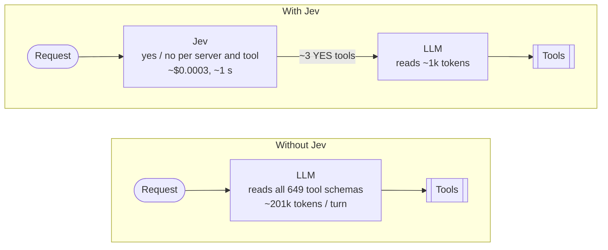
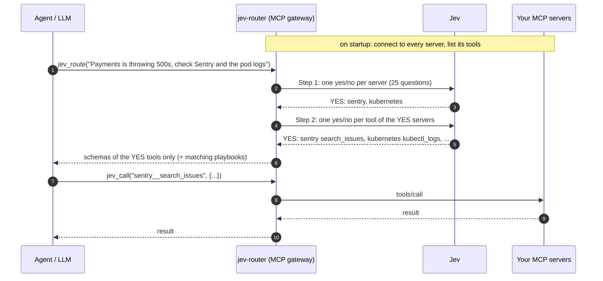

# jev-mcp-router

**Let a decision model pick your agent's MCP tools, not the LLM.**

An MCP gateway that sits between your AI agent and your MCP servers. For each
request, [Jev](https://typesafe.ai) (TypeSafe AI's "System One" decision model)
answers one yes/no question per server and per tool, and the LLM only ever sees
the handful of tools Jev said yes to.


## Why

With MCP, every tool from every connected server is put into the LLM's prompt on
every turn. Connect a few real servers (GitHub, Grafana, PagerDuty, Jira,
Kubernetes...) and that is hundreds of tools and ~200k tokens before the user's
request is even read. The LLM then spends expensive reasoning deciding which 2 or
3 of them to call.

Choosing tools is a decision, not a generation task. Jev doesn't generate text:
it takes a state plus typed questions and returns an answer per question, for about
$0.04 per million input tokens.



## Results

649 real tools from 25 MCP servers, 111 hand-labeled requests
([details](#benchmark)):

| | All needed tools picked | Cost to choose tools | Time to choose tools |
|---|---|---|---|
| **Jev (this repo)** | **95%** | **$0.0003** | **~1 s** idle, 2.0 s under load |
| Claude Sonnet 5, full catalog in prompt (cached) | 99% | $0.0101 | 3.2 s |
| Claude Haiku 4.5, same | 93% | $0.0031 | 1.8 s |
| GPT-5 nano, same | 86% | $0.0003 | 3.2 s |
| Embedding search, top 20 | 85% | ~$0 | <0.01 s |

Sonnet is more accurate. Jev gets close at 1/32 of the cost, and the LLM that does
the actual work sees ~1k tokens of tool schemas instead of ~201k.

## How it works



- **Small catalogs** (up to 40 tools and skills) are routed in a single Jev request.
- **Large catalogs** are routed in two steps: servers first (kept at p >= 0.3, tuned
  so a needed server is rarely dropped), then the tools of the kept servers. If a
  server is clearly needed but none of its tools clears 0.5, its top-ranked tool is
  taken anyway.
- **Skills / playbooks** (`skills/<name>/SKILL.md`) are routed the same way. The
  chosen playbook's text goes straight into the response, so the LLM doesn't spend
  a turn loading it.
- Jev returns a probability per question; the gateway turns it into a plain YES/NO.

Your agent connects to one MCP server, `jev-router`, which exposes two tools:

| Tool | What it does |
|---|---|
| `jev_route(request)` | Jev's decision: the input schemas of the YES tools and the text of the YES playbooks |
| `jev_call(tool, arguments)` | Calls the tool on the underlying MCP server |

## Quickstart

Requirements: Python 3.11+, [uv](https://docs.astral.sh/uv/), and an
[OpenRouter](https://openrouter.ai) API key (Jev is served through OpenRouter; a
direct TypeSafe key also works).

```sh
git clone https://github.com/ini8labs/jev-mcp-router.git
cd jev-mcp-router
uv sync
cp .env.example .env        # then put your OPENROUTER_API_KEY in .env
```

The repo ships with two mock MCP servers (Prometheus and VictoriaLogs, real tool
names, canned data for one incident), so everything below works out of the box:

```sh
uv run python -m jevmcp catalog                         # what Jev decides over
uv run python -m jevmcp route "why is checkout slow?"   # Jev's YES/NO only, no LLM
uv run python -m jevmcp run   "why is checkout slow?" --compare
                                                        # end to end, vs an LLM that sees every tool
uv run python -m jevmcp eval                            # routing accuracy on evals/queries.jsonl
```

No key yet? `JEV_FAKE=1 LLM_FAKE=1` runs offline with keyword stand-ins. Their
decisions are not Jev's; it's only for checking the wiring.

## Use it from Claude Code or Claude Desktop

**Claude Code**, from inside the cloned repo: `.mcp.json` already registers the
gateway, so just start `claude` there. Or add it from anywhere:

```sh
claude mcp add jev-router -- uv run --directory /path/to/jev-mcp-router python -m jevmcp serve
```

**Claude Desktop**, in `claude_desktop_config.json`:

```json
{
  "mcpServers": {
    "jev-router": {
      "command": "uv",
      "args": ["run", "--directory", "/path/to/jev-mcp-router", "python", "-m", "jevmcp", "serve"]
    }
  }
}
```

Then remove the servers that `jev-router` now fronts from the client's own config,
so their schemas stop being loaded directly.

## Connect your own MCP servers

Edit `mcp_servers.json` (same shape as Claude Desktop's `mcpServers`, stdio or HTTP),
or point `JEV_MCP_SERVERS` at another file:

```json
{
  "mcpServers": {
    "prometheus": {
      "description": "Prometheus: PromQL metric queries, metric names and metadata, scrape targets",
      "command": "docker",
      "args": ["run", "-i", "--rm", "-e", "PROMETHEUS_URL", "ghcr.io/pab1it0/prometheus-mcp-server:latest"],
      "env": { "PROMETHEUS_URL": "http://host.docker.internal:9090" }
    },
    "github": { "description": "GitHub: repos, issues, PRs, Actions", "url": "https://example.com/mcp" }
  }
}
```

- **`description`** is what Jev reads when choosing servers. One plain line about what
  the server is for works best. Without it, the server's tool names are used.
- **`tool_hints.json`** (optional) replaces a tool's description for routing only,
  keyed by `server__tool`. Use it for tools whose descriptions are boilerplate, and
  to mark catch-all tools ("run any kubectl command") as a last resort. The LLM
  still receives the original schema.
- `mcp_servers.real.json` has working entries for the real Prometheus and
  VictoriaLogs MCP servers.

## Benchmark

`bench/` reproduces the numbers above.

- **Catalog**: `bench/catalog/` holds the real tool lists of 25 MCP servers, captured by
  starting each one and calling `tools/list` (`bench/collect.py`): GitHub, Grafana,
  PagerDuty, Atlassian (Jira + Confluence), Kubernetes, Datadog, Sentry, AWS CloudWatch,
  Prometheus, VictoriaLogs, VictoriaMetrics, Supabase, MongoDB, Notion, Slack,
  Playwright, Terraform, Postgres, filesystem, git, fetch, time, memory, Context7,
  Google Maps.
- **Requests**: `bench/requests.jsonl`, 111 requests, each labeled with the tools it
  needs. A tool group like `["pagerduty__list_oncalls", "grafana__get_current_oncall_users"]`
  means any one of them is acceptable. 10 requests span several servers; 3 need no tool.
- **Scoring**: a request passes when every needed tool was selected. Extra tools are
  counted separately, since they cost schema tokens but don't break the answer.
- **LLM routers** get the same catalog (descriptions truncated to 300 characters, as
  Jev gets) as a cached system prompt and reply with a JSON list of tool ids.

```sh
uv run python bench/run.py report                         # re-score saved results, no API spend
uv run python bench/run.py router                         # the shipped router end to end (~$0.04)
uv run python bench/run.py llm anthropic/claude-sonnet-5  # an LLM router (~$1.10)
uv run --group bench python bench/run.py embed            # local embedding baseline
uv run python bench/latency.py                            # Jev latency on an idle connection
```

To start all 25 servers live behind the gateway (dummy credentials: routing works,
tool calls fail), build the Go-based ones first:

```sh
bench/install_servers.sh                                  # needs Go and git; npx/uvx servers fetch on demand
JEV_MCP_SERVERS=bench/mcp_servers.bench.json uv run python -m jevmcp route \
  "Payments is throwing 500s. Check Sentry, look at the pod logs in Kubernetes, post a summary to #incidents"
```

**Caveats.** One run; Jev's answers vary by a few points between runs. The requests
and labels were written by the same person who tuned the router, so expect somewhat
lower numbers on your own traffic. `tool_hints.json` was written after seeing which
tools failed; its +2 points are within run-to-run noise.

## Limitations

- **Jev picks tools, not arguments.** It can't write a PromQL query or an email body, so
  an LLM still fills in arguments. It just does so with ~3 tool schemas instead of 649.
- **No fallback yet.** If Jev misses a needed tool (about 1 request in 20 in the
  benchmark), the LLM has no way to ask for more. A `request_more_tools` escape hatch is
  the obvious next step.
- **Where Jev misses**: tools with almost no description, catch-all tools winning over
  the specific one, and the second action in two-part requests ("create a branch *and*
  switch to it").
- **Small setups don't need this.** Under ~30 tools with prompt caching, the saving is
  fractions of a cent per request.

## Configuration

| Variable | Default | |
|---|---|---|
| `OPENROUTER_API_KEY` | | Used for Jev and for the LLM in `run` / `eval` |
| `TYPESAFE_API_KEY` | | Alternative to OpenRouter for Jev (set `JEV_BASE_URL=https://api.typesafe.ai`) |
| `JEV_BASE_URL` | `https://openrouter.ai/api` | |
| `JEV_MODEL` | `jev-latest` | |
| `LLM_MODEL` | `anthropic/claude-sonnet-5` | Any OpenRouter model id |
| `JEV_MCP_SERVERS` | `mcp_servers.json` | Server config for the CLI and the gateway |
| `JEV_FAKE`, `LLM_FAKE` | `0` | `1` = offline keyword stand-ins |

## Layout

```
jevmcp/
  jev.py           Jev client: POST /v1/systemone, yes/no questions -> YES/NO, offline fake
  router.py        one-step / two-step routing, fallback
  catalog.py       MCP connections (Hub), tool calls, skills and hints loading
  gateway.py       the jev-router MCP server: jev_route, jev_call
  agent.py         end-to-end runs: Jev path vs LLM-only baseline, per-step cost
  llm.py           OpenRouter chat for arguments and answers, live pricing
  cli.py           catalog / route / run / eval / serve
mock_servers/      Prometheus + VictoriaLogs mocks for the quickstart
skills/            example SRE playbooks
evals/             17 labeled requests for the mock setup
bench/             649-tool catalog, 111 labeled requests, benchmark runner and results
docs/              the benchmark image and its HTML source
tool_hints.json    routing-only descriptions for badly described tools
```

## License

MIT. Jev is a model by [TypeSafe AI](https://typesafe.ai); this project is not affiliated
with TypeSafe AI and you need your own API access to use it.
